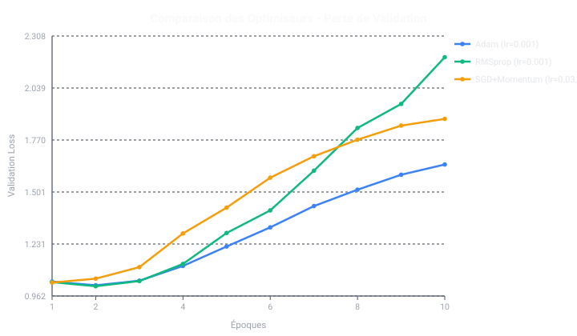
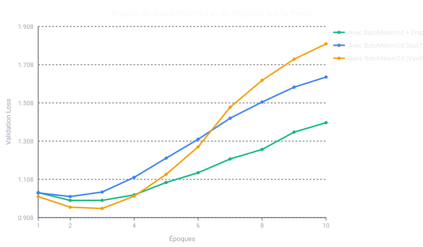

# MY_TORCH_ < A CLASH OF KINGS />

[](https://www.python.org/)
[]()
[]()

> *« Information is power (or is it "power is power"?). »*
>
> **MY_TORCH_** est une implémentation complète *from scratch* d'une bibliothèque de réseaux de neurones profonds en Python (sans PyTorch, TensorFlow ou Scikit-learn), couplée à un classifieur d'états d'échiquiers en notation FEN (*Checkmate*, *Check*, *Nothing* et classification par couleur).
>
> **Auteurs :** Esteban Kenzi & Nathan Muzay (EPITECH Marseille, Promo 2026).

---

## Visualiseur de positions

```sh
make visualize
./visu dataset/check/10_pieces.txt -30
```

Ouvre une fenêtre dédiée affichant la position de la **30ᵉ ligne**
(la première ligne porte le numéro 1). Les blancs sont en bas ; l'image indique
le joueur au trait, l'étiquette du dataset et la FEN. Le visualiseur utilise
Python 3 et Tkinter (`python3-tk` sous Debian/Ubuntu). Échap ferme la fenêtre.

Pour enregistrer une image SVG à un emplacement précis sans ouvrir la fenêtre :

```sh
./visu dataset/check/10_pieces.txt -30 --output /tmp/position.svg --no-open
```

## 📋 Table des matières

1. [Fonctionnalités & Architecture](#-fonctionnalités--architecture)
2. [Structure du Projet](#-structure-du-projet)
3. [Compilation & Installation](#-compilation--installation)
4. [Guide d'utilisation](#-guide-dutilisation)
   - [my_torch_analyzer](#1-my_torch_analyzer)
   - [my_torch_generator](#2-my_torch_generator)
5. [Mathématiques & Fondations Théoriques](#-mathématiques--fondations-théoriques)
   - [Propagation Avant & Rétropropagation](#propagation-avant--rétropropagation)
   - [Optimiseur Adam](#optimiseur-adam)
   - [Régularisation & MC-Dropout](#régularisation--mc-dropout)
6. [Représentation de l'Échiquier (Feature Engineering)](#-représentation-de-léchiquier-feature-engineering)
7. [Benchmarks & Justifications](#-benchmarks--justifications)
8. [Gestion des Erreurs (Code 84)](#-gestion-des-erreurs-code-84)

---

## 🚀 Fonctionnalités & Architecture

- **Moteur Neuronal Autonome (`my_torch`)** :
  - **Couches** : `Dense` (entièrement connectée), `Dropout` (régularisation & Monte Carlo Dropout).
  - **Activations** : `ReLU`, `LeakyReLU`, `Sigmoid`, `Tanh`, `Softmax` (stable).
  - **Pertes** : `CategoricalCrossEntropy`, `MeanSquaredError` (MSE), `BinaryCrossEntropy` (BCE).
  - **Optimiseurs** : `Adam` (avec moments adaptatifs et correction de biais), `SGD` (avec momentum), `RMSprop`.
  - **Initialiseurs** : `HeNormal`, `HeUniform`, `XavierNormal`, `XavierUniform`, `LeCunNormal`.
  - **Conteneur & Sérialisation** : Modèle `Sequential`, sauvegarde et chargement au format `.nn`.
- **Moteur d'Échecs Déterministe (`chess_engine`)** :
  - Validation et découpage complet de chaînes FEN.
  - Encodage en 773 descripteurs, ou 1 333 avec les entrées tactiques optionnelles.
  - Moteur de règles déterministe pour l'évaluation de la vérité terrain (*Nothing*, *Check*, *Checkmate*).
- **Outils en Ligne de Commande** :
  - `my_torch_analyzer` : Inférence (`--predict`) et ré-entraînement supervisé (`--train`).
  - `my_torch_generator` : Génération de réseaux aléatoires à partir de fichiers de configuration.

---

## 📁 Structure du Projet

```text
.
├── src/                            # Code Python du projet
│   ├── my_torch.py                 # Point d'entrée : clean, train, eval
│   ├── neural_network/             # Bibliothèque neuronale générique
│   │   ├── layers.py               # Layer, Dense, Dropout, BatchNorm
│   │   ├── activations.py
│   │   ├── losses.py
│   │   ├── optimizers.py
│   │   ├── initializers.py
│   │   ├── schedulers.py
│   │   ├── model.py                # Conteneur Sequential
│   │   └── serialization.py        # Lecture et sauvegarde .nn
│   ├── chess_engine/               # Parseur FEN, encodage et règles
│   ├── data/                       # Nettoyage, génération, classes communes
│   ├── training/                   # Entraînement et évaluation
│   ├── experiments/                # Benchmarks et hyperparamètres
│   └── cli/                        # Analyseur et générateur de réseaux
├── dataset/                        # Toutes les données FEN
│   ├── examples/                   # Petits corpus pour les tests et exemples
│   ├── for_train/                  # Sources train/test/validation
│   ├── cleaned/                    # Corpus nettoyés
│   └── check/, checkmate/, nothing/ # Sources brutes par catégorie (locales)
├── tests/                          # Tests automatisés
├── bonus/                          # IA jouable et visualiseur
├── tools/                          # Maintenance GitHub et génération de figures
├── doc/                            # Documentation et rapports
├── my_torch_network_*.nn           # Modèles préentraînés livrés
├── basic_network.conf              # Configuration d'exemple
├── medium_network.conf             # Architecture du modèle medium livré
├── full_network.conf               # Architecture du modèle full livré
├── tactical_network.conf           # Architecture tactique, 1 333 entrées
├── Makefile                        # Génère les lanceurs CLI à la racine
└── README.md
```

Les imports utilisent les packages `src.*`. `dataset/examples/` remplace
l'ancien dossier `datasets/` : ses petits fichiers servent aux tests, aux
exemples de prédiction et au repli de l'entraînement si le corpus nettoyé manque.
Les modèles `.nn` restent à la racine pour les commandes de livraison.

Depuis la racine, les modules spécialisés se lancent ainsi :

```bash
python3 -m src.training.train --help
python3 -m src.data.generation /tmp/chessboards.txt 900
python3 -m src.experiments.benchmark
python3 -m src.experiments.hyperparameter_tuning
```

Le point d'entrée `python3 src/my_torch.py` et les exécutables générés par
`make` restent les commandes usuelles.

---

## 🛠 Compilation & Installation

Le projet utilise `Makefile` conforme aux standards EPITECH :

```bash
# Compilation des exécutables
make

# Nettoyage des fichiers temporaires
make clean

# Nettoyage complet
make fclean

# Recompilation
make re

# Lancement des tests unitaires
make tests_run
```

`make fclean` supprime les caches Python et les lanceurs générés. `make` recrée
les commandes `my_torch_analyzer` et `my_torch_generator`. Les datasets,
configurations, rapports et modèles entraînés sont conservés. Les réseaux
vierges numérotés issus des quatre `.conf` sont ignorés par Git ; les modèles
préentraînés `my_torch_network_*.nn` restent versionnés.

---

## 📖 Guide d'utilisation

Le point d'entrée `src/my_torch.py` regroupe le nettoyage, l'entraînement et
l'évaluation du réseau (voir [le guide détaillé](doc/neural_network.md)) :

```bash
python3 src/my_torch.py -clean
python3 src/my_torch.py -train --dataset dataset/cleaned/train.txt --output model.nn --classes 5
python3 src/my_torch.py -eval --model model.nn --dataset dataset/cleaned/test.txt
```

Pour essayer les nouvelles entrées tactiques, avec un modèle distinct :

```bash
python3 src/my_torch.py -train --dataset dataset/cleaned/train.txt --output model_tactical.nn --classes 5 --encoding tactical
```

`--encoding basic` conserve les 773 entrées de référence (défaut).
`tactical` utilise 1 333 entrées : prise en passant, cartes d'attaque et
relations autour des rois. L'encodage est sauvegardé dans le modèle et choisi
automatiquement lors de l'évaluation et des prédictions.
Voir le [protocole de comparaison](doc/neural_network.md#comparer-les-encodages)
pour comparer les variantes sur une partition identique.

Le [rapport d'entraînement](doc/training_report.md) conserve les essais successifs,
les corrections des gradients et les protocoles de comparaison. Le dernier
entraînement tactique atteint **94,26 %** sur les mêmes 9 000 positions de
validation que la référence à **75,27 %**.

### 1. `my_torch_analyzer`

```bash
# Afficher l'aide
./my_torch_analyzer --help

# Mode prédiction (inférence sur un fichier d'échiquiers FEN)
./my_torch_analyzer --predict my_torch_network_basic.nn dataset/examples/sample_chessboards.txt

# Mode entraînement (avec sauvegarde dans un nouveau fichier)
./my_torch_analyzer --train --save my_torch_network_finetuned.nn my_torch_network_basic.nn dataset/examples/train_chessboards.txt
```

#### Exemple de sortie en prédiction :
```text
Checkmate
Nothing
Nothing
Check
Nothing
```

### 2. `my_torch_generator`

Génère des réseaux de neurones vierges initialisés aléatoirement selon un fichier descriptif :

```bash
./my_torch_generator basic_network.conf 3
# Génère: basic_network_1.nn, basic_network_2.nn, basic_network_3.nn
```

Les configurations sont à la racine :

| Fichier | Couches denses | Classes | Dropout |
| --- | --- | ---: | --- |
| `basic_network.conf` | 773 → 128 → 64 → 3 | 3 | 0,10 |
| `medium_network.conf` | 773 → 512 → 256 → 128 → 3 | 3 | 0,15 puis 0,10 |
| `full_network.conf` | 773 → 512 → 256 → 128 → 5 | 5 | 0,15 puis 0,10 |
| `tactical_network.conf` | 1333 → 512 → 256 → 128 → 5 | 5 | 0,25 après chaque couche cachée |

Les variantes medium et full utilisent BatchNorm et décrivent les couches des
modèles livrés. Leurs Dropout historiques diffèrent du défaut actuel de
`-train` (0,25 partout). La variante tactique reprend l'architecture actuelle
de `-train --encoding tactical`. Le fichier basic reste l'exemple d'origine.

```bash
# Générer un réseau vierge pour chaque variante
./my_torch_generator medium_network.conf 1 full_network.conf 1 tactical_network.conf 1

# Entraîner ensuite un réseau généré et sauvegarder ses poids
./my_torch_analyzer --train --save model_full_custom.nn full_network_1.nn dataset/cleaned/train.txt
```

La directive optionnelle `encoding basic` ou `encoding tactical` enregistre
l'encodage dans le `.nn` et vérifie sa compatibilité avec la première couche.
Les anciens fichiers sans cette directive restent acceptés. Les fichiers
générés ont des poids aléatoires ; les modèles préentraînés sont conservés.
Ces `.conf` servent au générateur ; `src/my_torch.py -train` continue à utiliser
l'architecture définie dans `src/training/train.py`.

---

## 🧮 Mathématiques & Fondations Théoriques

### Propagation Avant & Rétropropagation

Pour une couche dense linéaire avec entrée \(X \in \mathbb{R}^{B \times D_{in}}\) :
$$Y = X \cdot W + b$$

Lors de la rétropropagation du gradient de la perte \(L\) avec gradient amont \(dY = \frac{\partial L}{\partial Y}\) :
$$\frac{\partial L}{\partial W} = X^T \cdot dY$$
$$\frac{\partial L}{\partial b} = \sum_{i=1}^B dY_i$$
$$\frac{\partial L}{\partial X} = dY \cdot W^T$$

### Optimiseur Adam

Adam combine les bénéfices du momentum et de l'adaptation du taux d'apprentissage par coordonnées :
$$m_t = \beta_1 m_{t-1} + (1 - \beta_1) g_t$$
$$v_t = \beta_2 v_{t-1} + (1 - \beta_2) g_t^2$$
$$\hat{m}_t = \frac{m_t}{1 - \beta_1^t}, \quad \hat{v}_t = \frac{v_t}{1 - \beta_2^t}$$
$$\theta_t = \theta_{t-1} - \frac{\alpha}{\sqrt{\hat{v}_t} + \epsilon} \hat{m}_t$$

### Régularisation & MC-Dropout

Afin d'éviter le surapprentissage (**overfitting**) :
- **Inverted Dropout** à l'entraînement avec probabilité \(p\) :
  $$r_j \sim \text{Bernoulli}(1 - p), \quad \tilde{y} = \frac{r \odot y}{1 - p}$$
- **MC-Dropout** à l'inférence : maintien du dropout activé pour estimer la distribution de probabilité et l'incertitude épistémique.

---

## ♟ Représentation de l'Échiquier (Feature Engineering)

Chaque échiquier FEN est projeté dans un espace vectoriel de dimension **773** :
1. **Plans de pièces (768 descripteurs)** : 12 canaux binaires pour chaque case de l'échiquier (\(8 \times 8 = 64\) cases) représentant les pièces blanches (`P, N, B, R, Q, K`) et noires (`p, n, b, r, q, k`).
2. **Joueur au trait (1 descripteur)** : \(1.0\) pour les Blancs, \(0.0\) pour les Noirs.
3. **Droits de roque (4 descripteurs)** : Drapeaux binaires pour `K`, `Q`, `k`, `q`.

---

## 📊 Benchmarks & Preuves Visuelles

Résultats comparatifs obtenus avec le script `src/experiments/benchmark.py` et documentés dans [doc/benchmarks.md](doc/benchmarks.md) :

| Expérience | Configuration | Accuracy Val | Perte (Loss) | Temps |
| :--- | :--- | :---: | :---: | :---: |
| **Optimiseur** | SGD (lr=0.05, mom=0.9) | 59.00% | 0.9048 | 0.90s |
| | RMSprop (lr=0.001) | 59.33% | 0.9301 | 1.21s |
| | **Adam (lr=0.001)** | **55.33%** | **0.9703** | **1.40s** |
| **Régularisation**| Sans Dropout | 57.83% | 0.9081 | 1.20s |
| | **Avec Dropout (p=0.2)** | **57.83%** | **0.9303** | **1.35s** |

### Preuves Visuelles (Graphiques Vectoriels SVG)
- **Comparaison des Optimiseurs :**
  
- **Prévention de l'Overfitting (Effet du Dropout) :**
  

### Réseaux Pré-entraînés Livrés
- **`my_torch_network_basic.nn`** : Modèle 3 classes de base (`Nothing`, `Check`, `Checkmate`).
- **`my_torch_network_medium.nn`** : Modèle 3 classes entraîné sur corpus équilibré avec early stopping.
- **`my_torch_network_full.nn`** : Modèle 5 classes (`Nothing`, `Check White`, `Check Black`, `Checkmate White`, `Checkmate Black`).


---

## ⚠️ Gestion des Erreurs (Code 84)

Conformément à la convention EPITECH :
- Tout message d'erreur est dirigé vers `sys.stderr`.
- En cas d'anomalie (arguments manquants, fichier manquant ou illisible, FEN invalide), le programme quitte immédiatement avec le code de retour **84**.
- En cas de succès sans erreur, le code de retour est **0**.
